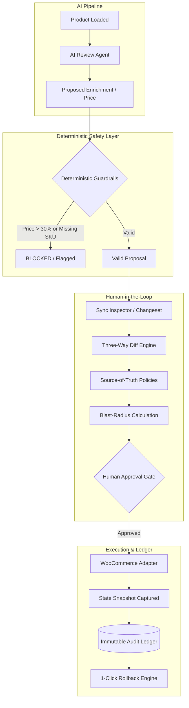

# VERIDEX
### Intelligent Product Catalog & Sync Platform

> **"AI proposes. Rules verify. Humans approve. VERIDEX synchronizes. The audit trail remembers everything."**

[](https://www.typescriptlang.org/)
[](https://reactjs.org/)
[](https://nodejs.org/)
[](https://vitejs.dev/)
[](https://tailwindcss.com/)
[](https://github.com/WiseLibs/better-sqlite3)
[](https://vitest.dev/)

---

## 1. Executive Overview

**VERIDEX** is an enterprise-grade Product Information Management (PIM) and bidirectional synchronization platform engineered for modern ecommerce operations. It safely reconciles product master catalogs with WooCommerce storefronts using an AI-assisted enrichment engine constrained by deterministic validation guardrails, three-way diff inspection, field-level source-of-truth policies, and an immutable audit ledger with one-click rollback.

---

## 2. The Problem Statement

Modern ecommerce brands managing multichannel inventory face four critical failure modes:
1. **Accidental Overwrites & Data Drift:** When catalog teams edit descriptions in PIM while marketing adjusts prices or warehouse managers update inventory directly in WooCommerce, two-way sync engines blindly overwrite the remote state or clobber local edits.
2. **Ungoverned AI Hallucinations:** Generative AI tools often recommend catastrophic price cuts (e.g. ₹9,999 to ₹999), invent non-existent categories (e.g. tagging Headphones as Footwear), or omit mandatory regulatory attributes.
3. **High Blast-Radius Deployments:** Catalog managers lack visibility into the downstream impact of bulk publishing before committing changes to live storefronts.
4. **Irreversible Sync Failures:** When a corrupted CSV import or bad sync job executes, stores lack atomic, one-click rollback to restore the exact pre-sync state without restoring an entire database backup.

---

## 3. The VERIDEX Solution

VERIDEX solves these challenges through a strict, multi-tiered architecture:



---

## 4. Key Architectural Pillars

### A. Three-Way Diff & Baseline State
Unlike naive tools that only compare current PIM vs remote WooCommerce, VERIDEX stores the last verified synchronized snapshot as a **BASELINE**:
```
        BASELINE
           |
   +-------+-------+
   |               |
  PIM         WooCommerce
```
For every field, VERIDEX calculates one of four deterministic states:
- `MATCH`: `PIM == BASELINE == WooCommerce` (in full synchronization).
- `PIM_CHANGED`: PIM modified locally; WooCommerce remains at baseline. Safe to push.
- `WOO_CHANGED`: Remote WooCommerce modified; PIM remains at baseline. Safe to pull.
- `CONFLICT`: Both PIM and WooCommerce modified away from baseline with differing values. Flagged for policy resolution or manual human review.

### B. Normalized Field Comparison Layer
WooCommerce frequently returns numeric fields as strings (e.g. `12999` vs `"12999"`), wraps descriptions in HTML paragraph tags, or formats arrays differently. VERIDEX features a centralized normalization engine (`server/src/utils/diffUtils.ts`) that guarantees zero false "Changed" flags:
- Numeric equivalence: `normalizeValue(12999) === normalizeValue("12999")`
- Whitespace & HTML sanitation: Standardizes trimmed content and strips tag noise.
- Array order-insensitivity: Tags and categories compare set equivalence regardless of order.

### C. Configurable Source-of-Truth Policies
Organizations define field ownership rules to automatically resolve conflicts:
```json
{
  "price": "PIM",
  "regular_price": "PIM",
  "sale_price": "PIM",
  "name": "PIM",
  "description": "PIM",
  "categories": "PIM",
  "attributes": "PIM",
  "stock_quantity": "WOOCOMMERCE"
}
```
If both systems modify stock, policy recommends **"Keep WooCommerce"** (warehouse truth). If both modify price, policy recommends **"Keep PIM"** (catalog pricing truth). Users can override recommendations at any time.

### D. Deterministic AI Guardrails
AI is strictly an advisory engine. Every AI recommendation must pass deterministic code validators before reaching human review:
- `PRICE_CHANGE_TOO_LARGE`: Flags or blocks price jumps above configurable threshold (default: 30%).
- `MISSING_SKU`: Hard blocks publishing products with missing SKU identifiers.
- `INVALID_PRICE`: Rejects negative prices or sale price >= regular price.
- `INVALID_STOCK`: Rejects negative inventory numbers.
- `CATEGORY_MISMATCH`: Ensures proposed category exists in active taxonomy.
- `IMAGE_REQUIRED`: Flags high-risk warnings for products lacking hero images.

### E. Explainable Quality Score (0–100)
Rather than an arbitrary number, catalog quality is deterministically scored with itemized deductions and positive bonuses:
- **Base Score:** 100
- **Deductions:**
  - Missing description: `-15 pts`
  - Missing brand: `-10 pts`
  - Missing product image: `-10 pts`
  - Missing required attributes: `-8 pts` per missing attribute
- **Positives:** Valid SKU, active stock inventory, conforming pricing rules.

### F. Blast-Radius Score
Before publishing, the Sync Inspector computes a risk rating:
- **LOW:** Metadata or description changes affecting few products.
- **MEDIUM:** Category changes or 3+ products updated.
- **HIGH:** Large price fluctuations, stock dropping to 0, or unresolved conflicts.

### G. Natural Language Bulk Operations
Users can enter operational commands in plain English:
> *"Raise all headphone prices by 5%, but skip products currently on sale."*
> *"Find products missing images and prepare them for review."*
> *"Set all low-stock products to draft."*

**Pipeline:**
1. Natural language intent parsed into structured `SyncChangeset`.
2. Deterministic validation checks each proposed change.
3. Dry Run generates a preview table with before/after diffs.
4. User selects or approves items.
5. Atomic application and ledger logging.

### H. Immutable Audit Ledger & 1-Click Rollback
Every sync operation stores a complete pre-sync state snapshot:
- `timestamp`, `product_id`, `direction`, `action`, `status`, `changed_fields`, `previous_snapshot`.
- **Rollback Guarantee:** Restoring a previous state applies the pre-sync snapshot to both PIM and WooCommerce while appending a **new** `rollback` ledger entry. History is **never** deleted or overwritten.

---

## 5. Technology Stack

### Frontend
- **Framework:** React 18 with TypeScript
- **Bundler:** Vite
- **Styling:** Vanilla CSS + Tailwind CSS v4 design tokens (enterprise light palette: `#111916` deep charcoal-green, pure white `#ffffff` canvas, `#15803d` emerald green accents, `#7c3aed` AI accents)
- **State & Caching:** TanStack React Query v5
- **Icons:** Lucide React
- **Routing:** React Router v6

### Backend
- **Runtime:** Node.js 20+ with ES Modules
- **Language:** TypeScript (`tsx`)
- **Web Framework:** Express.js
- **Database:** SQLite via `better-sqlite3` with WAL mode
- **AI Integration:** Google Gemini API (`@google/genai` with `gemini-2.5-flash` / heuristic fallback)
- **Storefront Adapter:** Pluggable WooCommerce Adapter (`MockWooCommerceClient` and `WooCommerceRestClient`)

---

## 6. Project Structure

```
kilowatt/
├── client/                      # React 18 Frontend
│   ├── public/assets/products/  # High-fidelity realistic product images & SVGs
│   ├── src/
│   │   ├── api/client.ts        # Type-safe API client
│   │   ├── components/
│   │   │   ├── AIBulkActionModal.tsx    # Natural language operations modal
│   │   │   ├── PreFlightDiffModal.tsx   # Three-way diff modal
│   │   │   ├── ProductEditorModal.tsx   # Catalog product editor
│   │   │   ├── Sidebar.tsx              # Resizable enterprise sidebar
│   │   │   └── TopBar.tsx               # Global search & breadcrumbs
│   │   ├── pages/
│   │   │   ├── LandingPage.tsx          # Public marketing & workflow page
│   │   │   ├── OverviewPage.tsx         # Workspace health & analytics
│   │   │   ├── CatalogPage.tsx          # Master product table & bulk actions
│   │   │   ├── AIReviewPage.tsx         # Agent trace & explainable quality scores
│   │   │   ├── SyncInspectorPage.tsx    # Three-way diff & blast radius
│   │   │   ├── SyncHistoryPage.tsx      # Immutable ledger & 1-click rollback
│   │   │   ├── SettingsPage.tsx         # Source-of-truth field policies
│   │   │   └── WooCommercePage.tsx      # Storefront connection & sync controls
│   │   └── types/index.ts       # Shared TypeScript definitions
│   └── package.json
│
├── server/                      # Node.js + Express Backend
│   ├── src/
│   │   ├── adapters/            # WooCommerce driver abstraction (Mock & REST)
│   │   ├── controllers/         # Express route controllers
│   │   ├── db/
│   │   │   ├── schema.sql       # SQLite DDL schema
│   │   │   └── seed.ts          # Canonical seed data for 6 demo scenarios
│   │   ├── repositories/        # Data access layer
│   │   ├── routes/              # API routes
│   │   ├── services/
│   │   │   ├── ai/
│   │   │   │   ├── aiAgentService.ts       # 8-step agent execution trace
│   │   │   │   ├── aiBulkActionService.ts  # Natural language changeset engine
│   │   │   │   ├── aiGuardrails.ts         # Deterministic safety validators
│   │   │   │   └── tools/index.ts          # Isolated MCP-ready tool layer
│   │   │   ├── blastRadiusService.ts   # Risk & impact calculator
│   │   │   ├── policyService.ts        # Source-of-truth ownership engine
│   │   │   ├── qualityScoreService.ts  # Deterministic score & deductions
│   │   │   └── syncService.ts          # Three-way diff & rollback engine
│   │   ├── utils/
│   │   │   └── diffUtils.ts            # Normalized comparison utilities
│   │   └── tests/                      # Vitest test suite (30 unit tests)
│   └── package.json
└── README.md
```

---

## 7. How to Run Locally

### Prerequisites
- Node.js 20.x or higher
- npm 9.x or higher

### Step 1: Clone the Repository
```bash
git clone https://github.com/sanashk19/PIM-kilowott.git
cd kilowatt
```

### Step 2: Configure Environment Variables
In `server/.env`:
```env
PORT=8000
NODE_ENV=development
DB_PATH=./data/pim_sentinel.db
AI_PROVIDER=google
GEMINI_API_KEY=your_gemini_api_key_here
GEMINI_MODEL=gemini-2.5-flash
WOO_DRIVER=mock
```
*(Note: If `GEMINI_API_KEY` is not provided, VERIDEX gracefully falls back to its deterministic heuristic AI engine without crashing).*

### Step 3: Install Dependencies
```bash
# In server directory:
cd server
npm install

# In client directory:
cd ../client
npm install
```

### Step 4: Seed the Canonical Demo Database
```bash
cd server
npm run seed
```
This populates the database with 10 realistic products specifically mapped to the 6 intentional demo scenarios.

### Step 5: Start Development Servers
```bash
# Terminal 1 - Backend:
cd server
npm run dev

# Terminal 2 - Frontend:
cd client
npm run dev
```

Access the application in your browser:
- **Landing Page:** `http://localhost:5173/`
- **Application Workspace:** `http://localhost:5173/app/overview`
- **Backend Health Check:** `http://127.0.0.1:8000/health`

---

## 8. Automated Testing

VERIDEX includes 30 comprehensive unit tests covering the core business logic:
```bash
cd server
npm test
```

### Test Coverage Highlights:
- **`diffUtils.test.ts` (11 tests):** Numeric string coercion (`12999` vs `"12999"`), whitespace stripping, null/empty handling, and array order-insensitivity.
- **`threeWayDiff.test.ts` (4 tests):** Verification of `MATCH`, `PIM_CHANGED`, `WOO_CHANGED`, and `CONFLICT` field classifications.
- **`aiGuardrails.test.ts` (4 tests):** Price spikes exceeding 30%, missing SKU blocking, category mismatch, and image requirement checks.
- **`qualityScore.test.ts` (4 tests):** Itemized scoring deductions and bonuses.
- **`rollback.test.ts` (1 test):** Snapshot restoration, state reversal, and immutable log creation.
- **`productCatalog.test.ts` (6 tests):** Category mapping integrity, attribute handling (e.g. 750ml capacity), and product count parity.

---

## 9. End-to-End Demo Script (6 Intentional Scenarios)

The seeded catalog is organized around 6 intentional demo scenarios:

| Product Name | SKU | Scenario | Expected Behavior |
| :--- | :--- | :--- | :--- |
| **Apex Pro Wireless Headphones** | `AUDIO-APX-001` | PIM Changed Price | Sync Inspector displays `PIM_CHANGED`. Safe to push. |
| **KeyCraft Mechanical Keyboard** | `KEY-02` | Woo Changed Stock | Sync Inspector displays `WOO_CHANGED`. Safe to pull or overwrite. |
| **Leather Crossbody Bag** | `BAG-LTH-01` | Real Conflict | PIM and Woo modified description differently. Status: `CONFLICT`. Source-of-truth policy recommends "Keep PIM". |
| **OriginRoasts Ethiopian Coffee** | `FOOD-COF-006` | Missing Image | AI Review flags quality deduction (`-10 pts`) for missing hero image. |
| **Ambient Rhythm LED Light Bar** | `LIGHT-AMB-01` | Guardrail Blocked | Proposed price increase from ₹2,499 to ₹3,499 (+40%) is blocked by `PRICE_CHANGE_TOO_LARGE` (>30%). |
| **AeroPress Travel Brew Kit** | `COF-AERO-01` | Full Match | State matches Baseline, PIM, and WooCommerce. Status: `MATCH`. |

### Walkthrough Steps:
1. **Catalog Overview:** Open `/app/overview` to view total catalog health (81/100) and verified 10/10 product count.
2. **AI Review Page:** Open `/app/ai-review`. Select **Ambient Rhythm LED Light Bar**. Observe the 8-step Agent Trace and see the deterministic guardrail block the +40% price jump.
3. **AI Bulk Operations:** In `/app/catalog`, click **"AI Bulk Actions"**. Click *"Raise all headphone prices by 5%"*. Notice the structured changeset preview before approving.
4. **Three-Way Sync Inspector:** Open `/app/sync-inspector`. Inspect **Leather Crossbody Bag** to view the `BASELINE | VERIDEX | WooCommerce` comparison. See policy recommend "Keep PIM" for description.
5. **Dry Run & Blast Radius:** Review the Blast-Radius Impact Card (Medium Risk: 1 Conflict, 2 Price Changes) before confirming sync.
6. **Execution & Rollback:** Execute sync, navigate to `/app/sync-history`, click **"Rollback"**, view the snapshot modal, and restore the previous state without altering audit history.

---

## 10. AI-Assisted Development Disclosure

In accordance with hackathon evaluation guidelines:
- **Architecture & System Design:** The three-way baseline diff model, state normalization engine, deterministic guardrail pipeline, and source-of-truth policy layer were architected and implemented with AI assistance.
- **Review & Verification:** All generated code was verified with TypeScript compiler type checks (`tsc -b`), linting, and 30 automated unit tests executed via Vitest.
- **Determinism Constraint:** The AI was strictly prohibited from modifying database state directly. Every AI recommendation must be transformed into a typed `SyncChangeset` validated by code guardrails.

---

## 11. Known Limitations & Future Improvements

- **Current Limitation:** In the current demonstration setup, WooCommerce communication defaults to an in-memory `MockWooCommerceClient` for offline portability.
- **Future Improvement:** Provide live OAuth 1.0a credentials in Settings to toggle seamlessly between staging mocks and live production stores.
- **Future Improvement:** Formal MCP (Model Context Protocol) JSON-RPC standard daemon wrapping the isolated tools in `server/src/services/ai/tools/index.ts`.

---

© 2026 VERIDEX — Intelligent Product Catalog & Sync Platform. Built for the Hackathon.
